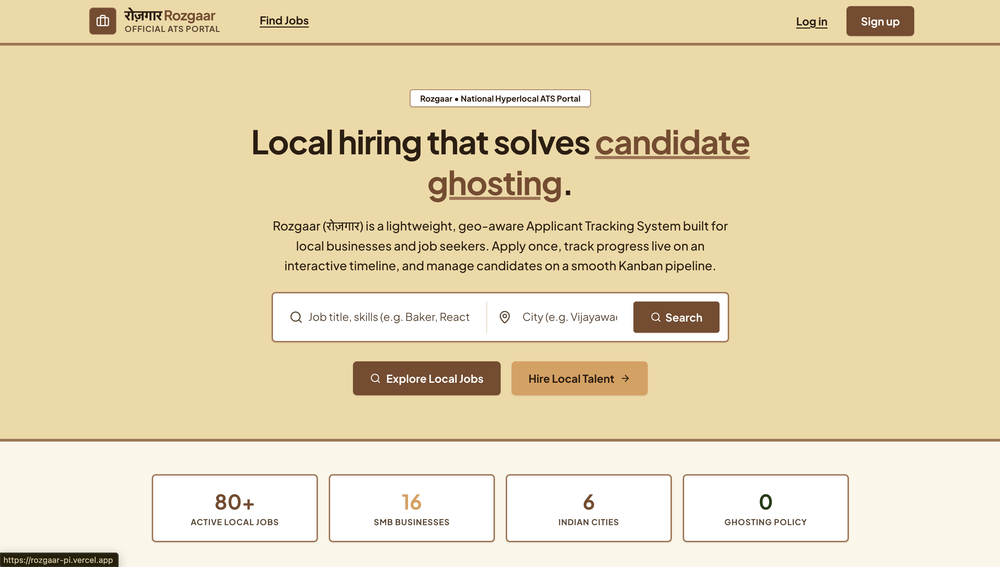

# Rozgaar (रोज़गार) — Local ATS

[](#)
[](#)
[](#)
[](#)
[](#)
[](#)
[](#)
[](#)

> **Rozgaar** (Hindi: **रोज़गार**, meaning *"employment"* or *"livelihood"*) is a full-featured, hyperlocal Applicant Tracking System (ATS) designed specifically for local small and medium businesses (SMBs) and job seekers in their community.

---
## Screenshots

Explore the Rozgaar platform through the following screenshots.

1. Authentication & Dashboards

<p align="center">
  
  
</p>
<p align="center">
  
  
</p>

2. Applicant Features

<p align="center">
  
  
</p>


## 1. Executive Summary & Problem Solved

Traditional recruitment platforms are built for global enterprise scale and remote corporate hiring, leaving neighborhood businesses (textile manufacturers, local warehouses, retail stores, logistics depots, craft studios, clinics, coaching centres) and nearby job seekers stranded. Furthermore, candidates face the ubiquitous **"ghosting problem"**, where applications vanish into a black hole with zero status visibility.

**Rozgaar solves this through:**
1. **Hyperlocal Geo-Proximity Search:** Search and sort jobs within a custom kilometer radius (`$geoNear` aggregation pipeline over 2dsphere indexes) with one-click GPS coordinate detection.
2. **Interactive Kanban Pipeline:** Recruiters manage candidates visually across stages (`applied`, `reviewing`, `interviewing`, `offered`, `hired`, `rejected`) using `@hello-pangea/dnd` drag-and-drop with fractional positioning, automatic column rebalancing, candidate drawer, ratings, and internal notes.
3. **Anti-Ghosting Live Timeline:** Job seekers track all applications from a unified dashboard featuring a live vertical status timeline (30s polling via TanStack Query), feedback notes directly from hiring managers, and fire-and-forget email notifications on every stage transition.
4. **Cloud-Native MongoDB Atlas:** Uses cloud-hosted MongoDB Atlas with SSL/TLS encryption, automated connection pooling, and automated schema index synchronization (`2dsphere`, text, compound, unique).
5. **Glassmorphism Design System:** Mobile-first responsive UI crafted with Tailwind CSS v4, dynamic light/dark theme switching, self-hosted typography, and high-contrast accessible surfaces.
6. **Privacy-First & GDPR by Design:** Strict privacy consent checkboxes upon registration, full JSON data export (`GET /profile/export`), complete account erasure with resume file deletion and application anonymization (`DELETE /profile`), and **zero** invasive demographic fields (strictly no age, photo, gender, or marital status).

---

## 2. Hard Constraints & Port Allocations

Rozgaar is built bare-metal for **macOS (Apple Silicon)** without Docker, containers, or deprecated packages:

| Service | Port | Description |
|---|---|---|
| **React Client** (Vite) | `5173` | Frontend UI with Tailwind CSS v4 & TanStack Query (`strictPort: true`, configured via `VITE_DEV_PORT`) |
| **Express API** | `4000` | REST API (Express 5, Node.js LTS, ES Modules, configured via `PORT`) |
| **MongoDB Database** | Cloud (Atlas) | MongoDB Atlas cloud cluster via SRV connection string (`MONGODB_URI`) |

> [!IMPORTANT]
> **No Docker & No Port 5000:** Rozgaar explicitly avoids port 5000 (which collides with the macOS AirPlay Receiver daemon) and operates strictly on dedicated ports `4000` and `5173`. Port 5000 is rejected at server and client startup with a clear error message.

---

## 3. Environment Variables Matrix

Rozgaar enforces strict environment-driven configuration using Zod schemas. The application refuses to start if required variables are missing or misconfigured. Hardcoded fallback URLs and ports are strictly prohibited.

### Backend (`server/.env`)

| Variable | Type | Required | Description | Example Placeholder |
|---|---|---|---|---|
| `NODE_ENV` | `string` | No (default: `development`) | Runtime environment (`development`, `production`, `test`) | `development` |
| `PORT` | `number` | **Yes** | API HTTP server port (Port 5000 is rejected) | `4000` |
| `CLIENT_ORIGIN` | `url` | **Yes** | Client origin used for CORS whitelist and email verification/reset links | `https://app.yourdomain.example` |
| `API_PUBLIC_URL` | `url` | **Yes** | Public base URL used for absolute API endpoints and file streaming URLs | `https://api.yourdomain.example` |
| `MONGODB_URI` | `string` | **Yes** | MongoDB Atlas SRV connection string | `mongodb+srv://<user>:<password>@<cluster>.mongodb.net/rozgaar?retryWrites=true&w=majority` |
| `JWT_ACCESS_SECRET` | `string` | **Yes** | Secret for signing short-lived access JWTs (min 32 characters) | `<32+_char_random_hex>` |
| `ACCESS_TOKEN_TTL` | `string` | No (default: `15m`) | Access token time-to-live | `15m` |
| `JWT_REFRESH_SECRET` | `string` | **Yes** | Secret for signing refresh tokens (min 32 characters) | `<32+_char_random_hex>` |
| `REFRESH_TOKEN_TTL` | `string` | No (default: `7d`) | Refresh token cookie time-to-live | `7d` |
| `STORAGE_DRIVER` | `string` | No (default: `local`) | File storage driver: `local` disk or `s3` bucket | `local` |
| `LOCAL_UPLOAD_DIR` | `string` | No (default: `./uploads`) | Local directory for uploaded resumes when `STORAGE_DRIVER=local` | `./uploads` |
| `AWS_REGION` | `string` | If `s3` | AWS region for S3 resume storage | `ap-south-1` |
| `AWS_ACCESS_KEY_ID` | `string` | If `s3` | AWS IAM Access Key ID | `<aws_access_key>` |
| `AWS_SECRET_ACCESS_KEY` | `string` | If `s3` | AWS IAM Secret Access Key | `<aws_secret_key>` |
| `S3_BUCKET` | `string` | If `s3` | Private AWS S3 bucket name | `rozgaar-resumes-prod` |
| `SMTP_HOST` | `string` | No | Nodemailer SMTP host (falls back to Ethereal mock in dev) | `smtp.ethereal.email` |
| `SMTP_PORT` | `number` | No | Nodemailer SMTP port | `587` |
| `SMTP_USER` | `string` | No | SMTP username | `<smtp_user>` |
| `SMTP_PASS` | `string` | No | SMTP password | `<smtp_password>` |
| `EMAIL_FROM` | `string` | No | From header for outgoing email notifications | `"Rozgaar <noreply@yourdomain.example>"` |
| `SEED_ALLOW` | `string` | No (default: `false`) | Must be `"true"` to authorize running database seeder | `true` |
| `SEED_DEMO_PASSWORD` | `string` | No | Shared password for seeded demo accounts | `RozgaarDemo2026!` |

### Frontend (`client/.env`)

| Variable | Type | Required | Description | Example Placeholder |
|---|---|---|---|---|
| `VITE_API_URL` | `url` | **Yes** | Base API URL for all Axios calls. Missing var halts build with error screen. | `https://api.yourdomain.example/api/v1` |
| `VITE_DEV_PORT` | `number` | No (default: `5173`) | Vite local dev server port (`strictPort: true`; 5000 prohibited) | `5173` |

---

## 4. MongoDB Atlas Setup Checklist

Follow these steps in your [MongoDB Atlas Console](https://cloud.mongodb.com/) to configure your cloud database:

1. **Create Database User:**
   - Go to **Security** → **Database Access**.
   - Create a user with **Password Authentication** and the **readWrite** role for the `rozgaar` database.
2. **Allow-List Your IP Address:**
   - Go to **Security** → **Network Access**.
   - Add your current IP address (or `0.0.0.0/0` during development).
3. **URL-Encode Special Characters in Password:**
   - If your Atlas password contains special characters (e.g. `@`, `#`, `$`, `%`, `:`, `/`, `&`), URL-encode them before placing into the connection string (e.g. `@` becomes `%40`, `#` becomes `%23`).
4. **Set Database Name in Connection String:**
   - Ensure the connection string includes the database name `/rozgaar` before query parameters:
     ```
     mongodb+srv://<username>:<password>@<cluster>.mongodb.net/rozgaar?retryWrites=true&w=majority
     ```
5. **Paste into `server/.env`:**
   - Save the SRV string in `server/.env` under `MONGODB_URI`.
   - Never commit `server/.env` to source control.

---

## 5. Quickstart & Verification Commands

### Step A: Verify Atlas Connectivity
Test the connection against your MongoDB Atlas cluster:
```bash
npm run db:ping
```
Expected output:
```
📡 Pinging MongoDB Atlas...
✅ MongoDB Atlas Connected: <cluster-host>/rozgaar
==========================================
🏓 Ping Successful!
🏷️  Database Name:  "rozgaar"
🌐 Cluster Host:   "<cluster-host>"
⏱️  Ping Response:  ok=1
==========================================
```

### Step B: Synchronize Cloud Database Indexes
Run once after your first Atlas connection to build all required `2dsphere`, text, compound, and unique indexes:
```bash
npm run db:indexes
```

### Step C: Seed Rich Dummy Data to MongoDB Atlas
The database seeder populates 16 SMB companies across 6 Indian cities, 20 recruiters, 80 jobs, 60 applicants with PDF resumes, 250 applications across all 7 stages, 45 notifications, and 6 moderation reports. All seeded records are tagged with `isSeed: true`.

```bash
# Standard seed (refuses to run unless SEED_ALLOW=true in server/.env)
npm run seed

# Reset seed data (removes only documents with isSeed: true, then seeds)
npm run seed:reset

# Dry-run calculation (shows planned counts without database writes)
npm run seed -- --dry-run

# Append mode (inserts records without deleting prior seeded records)
npm run seed -- --append
```

### Step D: Automated URL & Port Audit
Verify that zero hardcoded URLs, hostnames, ports, connection strings, or credentials exist across the codebase:
```bash
npm run check:urls
```
Expected output:
```
🔍 Rozgaar Codebase Audit: Checking for forbidden hardcoded URLs, ports, and hosts...
📂 Scanning root directory: /Users/.../Rozgaar

✅ Audit Passed: 0 violations found across 131 files.
✨ All URLs, ports, hosts, and cloud resources are strictly environment-driven.
```

### Step E: Launch Development Servers
Open two terminal tabs:

**Terminal 1 (Backend API):**
```bash
npm run dev:server
```

**Terminal 2 (Vite Frontend):**
```bash
npm run dev:client
```

Now open your configured client URL in your web browser.

---

## 6. Demo Accounts & Seed Data

All demo accounts share the password configured in `SEED_DEMO_PASSWORD` in `server/.env` (default: `RozgaarDemo2026!`):

| Role | Email | Password | Description / State |
|---|---|---|---|
| **Admin** | `admin@rozgaar.example` | Read from `SEED_DEMO_PASSWORD` | Global admin moderation queue (6 reported jobs, platform user audits, system metrics) |
| **Recruiter** | `recruiter@rozgaar.example` | Read from `SEED_DEMO_PASSWORD` | Owner of **Durga Sweets & Artisan Bakery** (Vijayawada) with a fully populated 7-stage Kanban board |
| **Applicant** | `applicant@rozgaar.example` | Read from `SEED_DEMO_PASSWORD` | **Aarav Sharma** (Vijayawada) - has real PDF resumes and applications across every Kanban stage (`applied`, `reviewing`, `interviewing`, `offered`, `hired`, `rejected`, `withdrawn`) |

### Additional Seeded Accounts:
- **15 additional companies** across Vijayawada, Guntur, Hyderabad, Visakhapatnam, Bengaluru, and Chennai (clinic, logistics, coaching, hardware, hotel, IT startup, spices, restaurant, salon, gym, school, pharmacy, electronics, travel desk, NGO).
- **19 additional recruiters** (`recruiter.amaravati@rozgaar.example`, `recruiter.deccan@rozgaar.example`, etc.).
- **59 additional applicants** (`applicant.2@rozgaar.example` to `applicant.60@rozgaar.example`) with real generated PDF resumes, varied skills, and saved jobs.

---

## 7. Flat Government-Portal Design System

The frontend features a clean, high-contrast, accessibility-first design system inspired by official public service portals:

- **Strict Brand Color Tokens:**
  - **Brown (`#A47251`):** Structural borders, dividers, card outlines, accents. Never used as small text or background for light text.
  - **Brand Dark (`#7A4A2B`) & Brand Darker (`#5E3820`):** Primary buttons, active navigation indicators, and prominent section links (7.4:1 contrast ratio with white text).
  - **Sand (`#F0D8A1`):** Navigation bar header, table headers, and category section bands.
  - **Mint (`#DCF0C3`):** Success badges, positive highlights, and verified candidate tags.
  - **Accent Orange (`#DD9E59`):** Secondary buttons and focal action pills.
  - **Solid Text (`#2E1D10`):** High-contrast body text and headings across all light surfaces (16:1 contrast ratio on white surfaces).
  - **Page Canvas (`#FBF6E9`):** Warm official background tone.
- **Component Architecture:**
  - Flat solid surfaces with crisp 1px borders and subtle elevation shadows (`0 1px 2px rgba(46,29,16,0.12)`).
  - Zero glassmorphism/backdrop-blur, zero decorative gradient meshes, zero neon glows.
  - Compact rounded corners (4px to 8px) with strict WCAG AAA color contrast compliance.
  - Prominent 3px solid focus rings with 2px offset on every interactive element.
  - Native "Skip to main content" link for full screen-reader keyboard accessibility.
  - Fully light-mode-only architecture respecting `prefers-reduced-motion`.
- **Realistic Seeded PDF Resumes:**
  - All 60 seeded applicant profiles are equipped with dynamically generated, valid PDF resumes.
  - Resumes include applicant full name, verified headline, contact details, regional location, professional summary, key skills, and hyperlocal verification credentials.
  - Binary magic byte validation (`%PDF-1.4`) ensures complete compatibility with browser PDF viewers and secure download endpoints.

---

## 8. Complete REST API Reference (`/api/v1`)

Standard response envelopes:
- **Success:** `{ data: <payload>, meta?: <pagination/counts> }`
- **Error:** `{ error: { code: <ERROR_CODE>, message: <string>, details?: <any> } }`

### Authentication (`/auth`)
| Method | Endpoint | Access | Description |
|---|---|---|---|
| `POST` | `/auth/register` | Public | Register new user (`applicant` or `recruiter`) |
| `POST` | `/auth/login` | Public | Authenticate user; returns access token & sets refresh cookie |
| `POST` | `/auth/refresh` | Public | Silent token refresh via `refreshToken` cookie |
| `POST` | `/auth/logout` | Authenticated | Revoke refresh token and clear cookie |
| `GET` | `/auth/me` | Authenticated | Fetch authenticated user profile & company |
| `POST` | `/auth/forgot-password` | Public | Generate 1-hour single-use password reset token |
| `POST` | `/auth/reset-password` | Public | Reset password using valid reset token |
| `POST` | `/auth/verify-email` | Public | Verify email address using token |

### Applicant Profile & Resumes (`/profile`)
| Method | Endpoint | Access | Description |
|---|---|---|---|
| `GET` | `/profile` | Applicant | Retrieve current applicant profile and resumes |
| `PUT` | `/profile` | Applicant | Update headline, bio, phone, location, skills, links |
| `POST` | `/profile/resumes` | Applicant | Upload PDF/DOCX (magic bytes checked, max 3, 5 MB limit) |
| `PATCH` | `/profile/resumes/:id` | Applicant | Set a specific resume as default |
| `DELETE` | `/profile/resumes/:id` | Applicant | Delete resume from storage and profile |
| `GET` | `/profile/resumes/raw/:key` | Auth (Owner/Recruiter)| Securely stream resume file from local storage |
| `GET` | `/profile/export` | Applicant | **GDPR Export:** Download complete JSON profile data |
| `DELETE` | `/profile` | Applicant | **GDPR Erasure:** Permanently wipe account & anonymize ATS data |

### Companies (`/companies`)
| Method | Endpoint | Access | Description |
|---|---|---|---|
| `POST` | `/companies` | Recruiter/Admin | Register new company profile with GeoJSON location |
| `GET` | `/companies/:id` | Public | Fetch public company details, members, and open jobs |
| `PUT` | `/companies/:id` | Recruiter (Owner)| Update company details |
| `POST` | `/companies/:id/members` | Recruiter (Owner)| Invite new team member by email |
| `GET` | `/companies/:id/jobs` | Public | Get all active job listings for a company |

### Jobs & Search (`/jobs`)
| Method | Endpoint | Access | Description |
|---|---|---|---|
| `GET` | `/jobs` | Public | Search jobs by keywords, lat/lng, radiusKm, type, salary |
| `GET` | `/jobs/:id` | Public | Get comprehensive job listing details |
| `POST` | `/jobs` | Recruiter | Post new job (statuses: `draft`, `open`, `closed`) |
| `PUT` | `/jobs/:id` | Recruiter | Update existing job listing |
| `PATCH` | `/jobs/:id/status` | Recruiter | Change job status (`draft`, `open`, `closed`) |
| `DELETE` | `/jobs/:id` | Recruiter | Remove job listing |
| `POST` | `/jobs/:id/save` | Applicant | Bookmark/save a job |
| `DELETE` | `/jobs/:id/save` | Applicant | Remove job bookmark |
| `GET` | `/jobs/saved` | Applicant | List all bookmarked jobs |
| `POST` | `/jobs/:id/report` | Authenticated | Report an offensive or fraudulent job listing |

### Applications & Kanban Pipeline (`/applications`)
| Method | Endpoint | Access | Description |
|---|---|---|---|
| `POST` | `/jobs/:jobId/applications` | Applicant | Submit application with resume snapshot and cover note |
| `GET` | `/applications/mine` | Applicant | List applicant's applications (sanitized timeline only) |
| `GET` | `/applications/:id` | Auth | Get single application (applicant sees timeline; recruiter sees full drawer) |
| `PATCH` | `/applications/:id/withdraw` | Applicant | Withdraw application (locks status from further moves) |
| `GET` | `/jobs/:jobId/applications` | Recruiter | Fetch all candidates on Kanban board |
| `PATCH` | `/applications/:id/stage` | Recruiter | Move stage (fractional position, optional note modal) |
| `POST` | `/applications/:id/notes` | Recruiter | Add internal team note (**strictly confidential**) |
| `PATCH` | `/applications/:id/rating` | Recruiter | Set 1-5 candidate rating (**strictly confidential**) |
| `GET` | `/applications/:id/resume-url`| Recruiter | Generate 5-minute presigned resume download URL |

### In-App Notifications (`/notifications`)
| Method | Endpoint | Access | Description |
|---|---|---|---|
| `GET` | `/notifications` | Authenticated | Get recent notifications and unread badge count |
| `PATCH` | `/notifications/:id/read` | Authenticated | Mark a single notification as read |
| `PATCH` | `/notifications/read-all` | Authenticated | Mark all notifications as read |

### Admin Moderation (`/admin`)
| Method | Endpoint | Access | Description |
|---|---|---|---|
| `GET` | `/admin/stats` | Admin | System aggregate metrics (users, companies, jobs, reports) |
| `GET` | `/admin/users` | Admin | Search and filter all registered platform users |
| `PATCH` | `/admin/users/:id/deactivate` | Admin | Deactivate/reactivate user account |
| `GET` | `/admin/companies` | Admin | Audit companies and active member counts |
| `GET` | `/admin/jobs` | Admin | Audit and filter all platform job postings |
| `PATCH` | `/admin/jobs/:id/close` | Admin | Force-close a violating job posting |
| `GET` | `/admin/reports` | Admin | Browse reported job queue by status |
| `PATCH` | `/admin/reports/:id` | Admin | Review report and optionally close reported job |

---

## 9. Testing & Quality Assurance

Rozgaar features a comprehensive automated test suite spanning unit tests, integration tests, security RBAC checks, and end-to-end user journeys:

```bash
# Run all tests (Server 70 tests + Client 2 tests = 72 tests)
npm test

# Run backend test suite only
npm run test:server

# Run frontend component test suite only
npm run test:client

# Run client production build
npm run build:client

# Run automated URL & port verification
npm run check:urls
```

---

## 10. Fractional Positioning Algorithm

In Rozgaar's Kanban board (`RecruiterKanbanPage.jsx`), candidate ordering within a column uses a **fractional positioning** scheme:

- **New Candidate:** Placed at `lastPosition + 1024` (or `1024` if the column is empty).
- **Dropped Between Candidate A and B:** `position = (posA + posB) / 2`.
- **Dropped at Top:** `position = firstPosition / 2`.
- **Dropped at Bottom:** `position = lastPosition + 1024`.
- **Automatic Rebalancing:** If the gap between cards shrinks below `1e-6` due to repeated insertions, the backend automatically re-indexes the entire column in increments of `1024` (`1024, 2048, 3072...`), completely eliminating floating-point precision exhaustion.

---

## 11. Security & Privacy Guarantees

1. **Anti-Ghosting Accountability:** Every stage transition requires an explicit stage history entry, triggering both an in-app notification and an asynchronous email notification to the candidate.
2. **Confidential Recruiter Notes:** Internal notes (`notes[]`) and candidate ratings (`rating`) are strictly scrubbed in all applicant-facing API endpoints via Mongoose's `toApplicantJSON()` model method.
3. **Cross-Tenant Isolation:** Recruiters can only access, review, and modify jobs and applications belonging to their own company organization.
4. **Rate Limiting & Generic Auth Errors:** Auth routes enforce strict IP rate limiting (`express-rate-limit`) and return generic `"Invalid email or password"` errors to block account enumeration attacks.
5. **Magic Byte Verification:** File uploads inspect binary header signatures (`fileTypeFromBuffer`) rather than trusting user-controlled MIME headers or file extensions.

---

## 12. License

Rozgaar is open source software released under the [MIT License](LICENSE).
